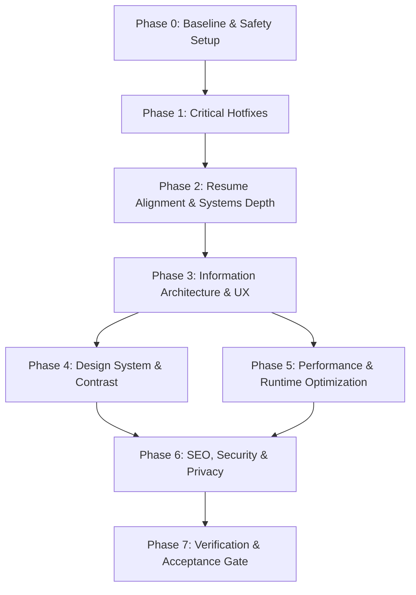

# Portfolio Redesign: Step-by-Step Implementation Roadmap
## `prabhatkarlekar.github.io` — Production Architecture, Execution Guide & Acceptance Gates

> **Author**: Prabhat Vilas Karlekar  
> **Repository**: [PrabhatKarlekar/prabhatkarlekar.github.io](https://github.com/PrabhatKarlekar/prabhatkarlekar.github.io)  
> **Source Directory**: `docs/` (Published directly to GitHub Pages)  
> **Standard**: Production Vanilla Web Architecture (HTML5, Modern CSS3 with Custom Properties, ES6+ Progressive Enhancement)  
> **Guiding Principle**: *Trustworthy before impressive. Non-destructive updates. Sub-second performance.*

---

## Table of Contents
1. [Core Principles & Confirmed Decisions](#1-core-principles--confirmed-decisions)
2. [Master Phase Overview & Dependency Graph](#2-master-phase-overview--dependency-graph)
3. [Phase 0: Baseline & Safety Setup](#phase-0-baseline--safety-setup)
4. [Phase 1: Critical Functional Fixes & Reliability (Hotfix Track)](#phase-1-critical-functional-fixes--reliability-hotfix-track)
5. [Phase 2: Resume Alignment & Deep Systems Engineering](#phase-2-resume-alignment--deep-systems-engineering)
6. [Phase 3: Information Architecture & UX Structure](#phase-3-information-architecture--ux-structure)
7. [Phase 4: Design System & Contrast Rectification](#phase-4-design-system--contrast-rectification)
8. [Phase 5: Performance & Runtime Optimization](#phase-5-performance--runtime-optimization)
9. [Phase 6: SEO, Security, Accessibility & Privacy](#phase-6-seo-security-accessibility--privacy)
10. [Phase 7: Verification & Acceptance Gate](#phase-7-verification--acceptance-gate)
11. [Git Workflow & Commit Protocol](#11-git-workflow--commit-protocol)

---

## 1. Core Principles & Confirmed Decisions

### 1.1 Non-Negotiable Engineering Rules
1. **Zero Content Erasure (Non-Destructive Update)**:
   - All foundational education (Class X, Class XII CBSE) and all 10+ professional certifications (Google, IBM, Coursera) are preserved.
   - 2025–2026 credentials (Microsoft Azure, C-DAC Pune HPC, Qualcomm 5G, C-DAC Hyderabad) sit prominently at the top; older credentials flow into a compact, high-density grid.
2. **Progressive Enhancement & No-JS Resilience**:
   - Content is 100% visible (`opacity: 1`) by default in semantic HTML and CSS.
   - If JavaScript is disabled, blocked, or throws an unhandled error, the entire site remains readable, navigable, and styled.
   - Animations apply strictly via `.js .reveal-item` under `@media (prefers-reduced-motion: no-preference)`.
3. **Google-Homepage Lightness & Zero Bloat**:
   - No heavy frameworks (no React, Next.js, or Tailwind bloat).
   - Drop the 70-particle $O(n^2)$ canvas animation and backdrop blurs that exhaust mobile CPUs.
   - Replace Font Awesome (~250 KB) with an inline SVG sprite (<4 KB).
   - Zero third-party runtime dependencies (no Vercel stats card, no Formspree/Web3Forms).

### 1.2 Locked-In User Decisions
- **Display Name**: `Prabhat Vilas Karlekar` (Header, Title, Citations, Meta, Resume). Handle `pritvikarlekar` retained for email and GitHub.
- **Positioning**: *"Software Engineer — HPC, Cryptographic Systems & Distributed Infrastructure"*.
- **PAYF Status**: **Internal to C-DAC**. Primary button states `"Request Access / Architecture Spec"`.
- **Metrics**: **Retain all documented metrics** (`85%+ accuracy`, `80% privacy leakage reduction`, `2.5x speedup`, `40% regression reduction`, `12 features analyzed`). Fix unit formatting via `data-suffix="%"` and integer display.
- **Research Output**: **2 Research Papers** in hero highlight (1 Published in IEEE SCI 2025 + 1 Under Review).
- **Contact Route**: Direct `mailto:pritvikarlekar@gmail.com` + 1-click vanilla "Copy Email" button.
- **Resume Filename**: Canonical, permanent URL: `docs/Prabhat_Karlekar_Resume.pdf`.

---

## 2. Master Phase Overview & Dependency Graph



---

## Phase 0: Baseline & Safety Setup

*Prerequisites: Clean Git working tree on `main`.*

### `STEP-0.1`: Tag Current Production State
- **Command**:
  ```powershell
  git tag -a v1-before-redesign -m "Release v1.0: Snapshot before editorial redesign and performance tuning"
  ```
- **Verification**: `git tag -l` lists `v1-before-redesign`.

### `STEP-0.2`: Create Dedicated Working Branch
- **Command**:
  ```powershell
  git checkout -b redesign/editorial-minimal
  ```
- **Verification**: `git status` confirms active branch is `redesign/editorial-minimal`.

### `STEP-0.3`: Measure Initial Audit Baselines
- **Actions**:
  1. Record current bundle sizes:
     - `docs/index.html` (~42 KB)
     - `docs/css/style.css` (~60 KB)
     - `docs/js/script.js` (~17 KB)
  2. Run Lighthouse audit locally on `http://localhost:8000` via python `http.server` or local preview.
  3. Save baseline scores for Performance, Accessibility, Best Practices, and SEO.

---

## Phase 1: Critical Functional Fixes & Reliability (Hotfix Track)

*Target: Fix bugs that break user trust, mobile navigation, or site accessibility.*

### `STEP-1.1`: Accessible Mobile Navigation Menu
- **Files**: `docs/index.html` (lines 35–75), `docs/css/style.css` (lines 170–210), `docs/js/script.js` (lines 330–345).
- **Action**:
  1. Add semantic hamburger button inside `.navbar` in `docs/index.html`:
     ```html
     <button id="mobile-nav-toggle" class="mobile-nav-toggle" aria-expanded="false" aria-controls="primary-nav" aria-label="Toggle navigation">
       <span class="hamburger-bar"></span>
       <span class="hamburger-bar"></span>
       <span class="hamburger-bar"></span>
     </button>
     ```
  2. In `docs/css/style.css`, create clean responsive drawer rules under `@media (max-width: 768px)`:
     - Visible toggle button; hidden on desktop (`display: none`).
     - Animated slide-down or side drawer for `.nav-links`.
     - High contrast background with solid surface color (`var(--card-bg)`) and clean 1px border.
  3. In `docs/js/script.js`:
     - Implement toggle handler updating `aria-expanded="true|false"`.
     - Close drawer when any `.nav-link` is clicked.
     - Close drawer on `Escape` keypress.
     - Prevent background page scrolling when menu is open (`document.body.classList.toggle('nav-open')`).
- **Testing**: On mobile viewport (360px and 375px), tap hamburger; verify menu opens smoothly, links navigate and auto-close drawer, Escape key closes drawer.

### `STEP-1.2`: Direct Action Bar (Replace Fake Contact Form)
- **Files**: `docs/index.html` (lines 725–765), `docs/css/style.css` (lines 1350–1440), `docs/js/script.js` (lines 145–175).
- **Action**:
  1. In `docs/index.html`, replace the non-functional `<form id="contact-form">` with a high-contrast `.contact-action-bar`:
     ```html
     <div class="contact-action-bar">
       <a href="mailto:pritvikarlekar@gmail.com" class="btn btn-primary contact-cta">
         <svg class="icon" aria-hidden="true"><use href="#icon-mail"/></svg>
         <span>Send Email</span>
       </a>
       <button id="copy-email-btn" class="btn btn-secondary" aria-label="Copy email address to clipboard">
         <svg class="icon" aria-hidden="true"><use href="#icon-copy"/></svg>
         <span id="copy-text">Copy Email</span>
       </button>
     </div>
     ```
  2. In `docs/js/script.js`, remove fake submit interceptor and empty `FormData` logging. Add 1-click clipboard handler:
     ```javascript
     const copyBtn = document.getElementById('copy-email-btn');
     if (copyBtn) {
       copyBtn.addEventListener('click', async () => {
         try {
           await navigator.clipboard.writeText('pritvikarlekar@gmail.com');
           const textSpan = document.getElementById('copy-text');
           const origText = textSpan.textContent;
           textSpan.textContent = 'Copied to Clipboard!';
           copyBtn.classList.add('btn-copied');
           setTimeout(() => {
             textSpan.textContent = origText;
             copyBtn.classList.remove('btn-copied');
           }, 2000);
         } catch (err) {
           window.location.href = 'mailto:pritvikarlekar@gmail.com';
         }
       });
     }
     ```
- **Testing**: Click "Copy Email"; verify clipboard contains `pritvikarlekar@gmail.com` and visual feedback toggles for 2 seconds. Click "Send Email"; verify default mail client triggers.

### `STEP-1.3`: Metric Suffix Bug & Integer Formatting
- **Files**: `docs/index.html` (lines 125–136, 545–555), `docs/js/script.js` (lines 295–330).
- **Action**:
  1. In `docs/index.html`, assign explicit `data-target`, `data-suffix`, and `data-decimals`:
     ```html
     <!-- Hero Stats -->
     <div class="stat-number" data-target="3" data-suffix="+">3+</div>
     <div class="stat-number" data-target="2" data-suffix="">2</div>
     <div class="stat-number" data-target="1" data-suffix="">1</div>
     <!-- Project Metrics -->
     <div class="metric-value" data-target="85" data-suffix="%">85%</div>
     <div class="metric-value" data-target="80" data-suffix="%">80%</div>
     <div class="metric-value" data-target="2.5" data-suffix="x" data-decimals="1">2.5x</div>
     <div class="metric-value" data-target="12" data-suffix="">12</div>
     ```
  2. In `docs/js/script.js`, update the count-up animation:
     - Read `const suffix = el.getAttribute('data-suffix') || '';`
     - Read `const decimals = parseInt(el.getAttribute('data-decimals') || '0', 10);`
     - Format number via `currentVal.toFixed(decimals) + suffix`.
- **Testing**: Confirm "Accuracy" renders as **85%** (never `85.0x`), "Features Analyzed" as **12** (never `12.0x`), and speedup as **2.5x**.

### `STEP-1.4`: Cryptographic Terminology Correction
- **Files**: `docs/index.html` (line 637).
- **Action**: Change `"SHA encryption for vote immutability"` to **"SHA-256 cryptographic hashing for ballot integrity and immutability"**.
- **Testing**: Search repository for any remaining instances of "SHA encryption"; verify 0 occurrences.

### `STEP-1.5`: Dead Link Cleanup & Canonical Resume Links
- **Files**: `docs/index.html` (lines 69, 509, 510, 525, 700, 775).
- **Action**:
  1. Line 509 (PAYF View Source): Change anchor text to **"Request Access / Architecture Spec"** with `href="#contact"` or spec modal trigger.
  2. Line 510 (PAYF Live Demo): Remove `href="#"`; replace with `<details>` spec drawer trigger.
  3. Lines 514–533 (GreyMisnomer): Add badge **"RFC Specification Draft"** and link to GitHub specification draft.
  4. Lines 69, 700, 775: Change `href="Prabhat Karlekar RTJ 26.pdf"` to canonical `href="Prabhat_Karlekar_Resume.pdf"`.
- **Testing**: Run automated link checker or manual sweep; verify zero `href="#"` dead ends.

### `STEP-1.6`: Progressive Enhancement & Visible-by-Default Fallback
- **Files**: `docs/css/style.css` (lines 635–650, 1015–1030), `docs/js/script.js` (lines 1–25, 290–305).
- **Action**:
  1. In `docs/css/style.css`:
     - Remove default `opacity: 0` on `.section`, `.timeline-item`, and `.project-card`. Set `opacity: 1` by default.
     - Scope entrance transforms exclusively to JavaScript-enhanced environments:
       ```css
       @media (prefers-reduced-motion: no-preference) {
         html.js .reveal-item {
           opacity: 0;
           transform: translateY(16px);
           transition: opacity 0.5s ease, transform 0.5s ease;
         }
         html.js .reveal-item.visible {
           opacity: 1;
           transform: translateY(0);
         }
       }
       ```
  2. In `docs/js/script.js`:
     - Add `document.documentElement.classList.add('js');` at top of file.
- **Testing**: Disable JavaScript in browser settings; reload. Verify all text, experience timelines, project cards, and education are 100% visible and formatted.

### `STEP-1.7`: Defensive JavaScript & FOUC Prevention
- **Files**: `docs/index.html` (head section), `docs/js/script.js` (lines 30–60).
- **Action**:
  1. Add tiny inline script in `<head>` of `docs/index.html` before any CSS links:
     ```html
     <script>
       (function() {
         try {
           var savedTheme = localStorage.getItem('theme');
           var prefersDark = window.matchMedia('(prefers-color-scheme: dark)').matches;
           var theme = savedTheme || (prefersDark ? 'dark' : 'light');
           document.documentElement.setAttribute('data-theme', theme);
         } catch (e) {
           document.documentElement.setAttribute('data-theme', 'light');
         }
       })();
     </script>
     <meta name="color-scheme" content="light dark">
     ```
  2. In `docs/js/script.js`:
     - Wrap all `localStorage` reads/writes in safe `try/catch` helper functions.
     - Wrap each initialization function in `init()` within its own `try/catch` block:
       ```javascript
       function init() {
         try { initTheme(); } catch(e) { console.error('Theme init error:', e); }
         try { initMobileNav(); } catch(e) { console.error('Nav init error:', e); }
         try { initScrollSpy(); } catch(e) { console.error('ScrollSpy init error:', e); }
         try { initMetrics(); } catch(e) { console.error('Metrics init error:', e); }
       }
       ```
- **Testing**: Open in Private/Incognito window with cookies/storage blocked; verify page initializes completely without throwing uncaught exceptions. Reload in dark mode; verify zero flash of light mode.

---

## Phase 2: Resume Alignment & Deep Systems Engineering

*Target: Accurately align portfolio with the Oct 2026 resume, showcase systems engineering depth, and preserve all credentials.*

### `STEP-2.1`: Canonical Resume Deployment
- **Files**: `docs/Prabhat_Karlekar_Resume.pdf`, `docs/index.html`.
- **Action**:
  1. Copy `docs/Prabhat_Karlekar_Resume_Oct_26.pdf` to canonical `docs/Prabhat_Karlekar_Resume.pdf`.
  2. Confirm PDF contains clean selectable text and Title/Author metadata.
  3. Ensure phone number is excluded from the public PDF version if desired for privacy.
- **Testing**: Open `docs/Prabhat_Karlekar_Resume.pdf` in browser; verify all text renders crisply and download link works from all 3 buttons on the page.

### `STEP-2.2`: Hero Section Positioning & Identity Rewrite
- **Files**: `docs/index.html` (lines 80–140).
- **Action**:
  1. Name: Change headline to **Prabhat Vilas Karlekar**.
  2. Badge: **"Software Engineer — HPC, Cryptographic Systems & Distributed Infrastructure"**.
  3. Replace typewriter with clean, authoritative positioning copy:
     > *"Software Engineer with 3+ years building high-performance, privacy-preserving systems across HPC, cryptography, federated learning, and distributed infrastructure. IEEE-published researcher. Currently leading protocol design and R&D at C-DAC Pune."*
  4. Set initial stat numbers in HTML (never "0"): `3+ Years`, `2 Research Papers`, `1 IEEE Publication`.
- **Testing**: View hero at desktop and mobile; confirm clean layout, zero jumping text, and authoritative tone.

### `STEP-2.3`: C-DAC Pune R&D Role Expansion
- **Files**: `docs/index.html` (lines 180–215).
- **Action**:
  1. Title line: Update department to **"HPC Infrastructure & Ecosystem (I&E)"**.
  2. Add leadership bullet:
     - *"Lead a 4–5 person R&D team designing and implementing secure high-throughput protocol specifications, distributed architectures, and cryptographic workflows."*
  3. Detail specification authoring:
     - *"Author Invention Disclosure Forms (IDFs), whitepapers, and IETF-RFC style protocol specifications for privacy-preserving data exchange."*
- **Testing**: Verify C-DAC timeline entry accurately balances systems implementation with technical leadership.

### `STEP-2.4`: Systems Engineering Depth in Featured Project Cards
- **Files**: `docs/index.html` (lines 480–650).
- **Action**:
  1. **PAYF Card**:
     - Status Badge: `Active R&D (C-DAC Internal)`
     - Architecture Depth: Highlight **Rust / Axum** asynchronous REST APIs, **PostgreSQL** schema design, **FlowCache** transactional caching, and **Yew / WebAssembly (WASM)** settlement dashboard.
     - Cryptography: **Ed25519** digital signatures + **CKKS Homomorphic Encryption**.
     - Action: *"Request Access / Architecture Spec"*
  2. **GreyMisnomer Card**:
     - Status Badge: `RFC Specification Draft`
     - Architecture Depth: **IETF-RFC style protocol specification**, **Two-Proof Model (`PoI` Proof-of-Individuality + `PoO` Proof-of-Origin)** for Sybil-resistant decentralized identity.
  3. **Privacy-Preserving Federated Learning Framework**:
     - Status Badge: `Research Prototype`
     - Align date to **September 2025** (matches resume).
     - Architecture Depth: **Lattice-based CKKS Homomorphic Encryption**, evaluated on **2-Client HPC cluster**.
     - Documented Metrics: Retain `85%+ accuracy` (walk-forward time-series forecasting), `80% privacy leakage reduction` (against membership inference attacks), `2.5x speedup` (MPI accelerated aggregation).
  4. **IEEE SCI 2025 Publication Card**:
     - Status Badge: `Published — IEEE SCI 2025`
     - Add full citation: Authors, full venue title, DOI link, 2025 publication year.
- **Testing**: Review all cards; ensure each communicates concrete systems engineering and mathematical depth.

### `STEP-2.5`: Non-Destructive Education & Certifications Layout
- **Files**: `docs/index.html` (lines 240–340), `docs/css/style.css` (lines 750–880).
- **Action**:
  1. Retain 100% of educational records: Class X (CBSE), Class XII (CBSE), B.Tech (Computer Science & Engineering, 9.06 CGPA).
  2. Retain 100% of certifications:
     - Prominently feature: **Microsoft Certified: Azure Fundamentals (May 2026)**, **C-DAC Pune Certified HPC Professional (Jan 2026)**, **Qualcomm 5G & Systems**, **C-DAC Hyderabad**.
     - Neatly group foundational credentials: All 2022–2023 Google, IBM, and Coursera certificates.
  3. In `docs/css/style.css`, style credentials as a compact 3-column dense grid (`grid-template-columns: repeat(auto-fit, minmax(280px, 1fr))`) with subtle 1px borders, small padding, and clean year chips.
- **Testing**: Verify all 10+ certifications are present, readable, and take up minimal vertical scroll.

---

## Phase 3: Information Architecture & UX Structure

*Target: Optimize section order, standardize card layouts, and enable fast scannability.*

### `STEP-3.1`: Section Hierarchy Reordering
- **Files**: `docs/index.html`.
- **Action**: Reorder main sections into logical presentation flow:
  1. `#hero` — Introduction, Positioning, Quick CTAs
  2. `#work` — Selected Work & Research Projects (PAYF, GreyMisnomer, FL Framework, IEEE Paper)
  3. `#experience` — Career Progression (C-DAC Pune, Reliance Jio)
  4. `#capabilities` — Grouped Technical Skills
  5. `#credentials` — Education & Compact Certification Archive
  6. `#contact` — Contact Action Bar
- **Testing**: Check page flow; verify top work is immediately visible to visitors after the hero.

### `STEP-3.2`: Navigation & Anchors Unification
- **Files**: `docs/index.html`, `docs/js/script.js`.
- **Action**:
  1. Synchronize navigation bar and footer anchors:
     `#work` (Work & Research), `#experience` (Experience), `#capabilities` (Skills), `#credentials` (Education), `#contact` (Contact).
  2. Set section headings to match nav labels identically.
  3. Implement `IntersectionObserver` scroll-spy in `docs/js/script.js`:
     - Highlight active nav item as user scrolls past sections.
     - Eliminate window scroll event thrashing and `offsetTop` queries.
- **Testing**: Scroll through page; verify active navbar pill smoothly tracks current visible section.

### `STEP-3.3`: Native `<details>` Architecture Spec Drawers
- **Files**: `docs/index.html`, `docs/css/style.css`.
- **Action**:
  1. Inside each project card, add a zero-dependency HTML `<details class="project-spec-drawer">`:
     ```html
     <details class="project-spec-drawer">
       <summary class="spec-toggle-btn">
         <span>View Architecture & Protocol Spec</span>
         <svg class="chevron-icon" aria-hidden="true"><use href="#icon-chevron"/></svg>
       </summary>
       <div class="spec-content">
         <!-- Protocol sequence, threat model, or architectural block diagram -->
       </div>
     </details>
     ```
  2. Add clean CSS animation on drawer expand/collapse without external libraries.
- **Testing**: Click "View Architecture & Protocol Spec"; verify drawer opens smoothly and displays detailed architecture without leaving the page.

---

## Phase 4: Design System & Contrast Rectification

*Target: Google-grade visual design — crisp 1px borders, clean typography, verified WCAG AA contrast.*

### `STEP-4.1`: Centralize CSS Variables & Tokens
- **Files**: `docs/css/style.css` (lines 1–60).
- **Action**:
  1. Replace 20+ hardcoded `rgba(59, 130, 246, ...)` values with CSS token references.
  2. Refine token palette:
     ```css
     :root {
       --bg-primary: #ffffff;
       --bg-secondary: #f8fafc;
       --card-bg: #ffffff;
       --border-subtle: #dadce0; /* Crisp Google-style 1px border */
       --text-primary: #0f172a;
       --text-muted: #475569;
       --accent-primary: #2563eb;
       --accent-hover: #1d4ed8;
       --radius-sm: 6px;
       --radius-md: 10px;
       --radius-lg: 16px;
     }
     [data-theme="dark"] {
       --bg-primary: #0b0f17;
       --bg-secondary: #111827;
       --card-bg: #1e293b;
       --border-subtle: #334155;
       --text-primary: #f8fafc;
       --text-muted: #94a3b8;
       --accent-primary: #3b82f6;
       --accent-hover: #60a5fa;
     }
     ```
- **Testing**: Check both themes; verify consistent borders, clean card separation, and zero neon oversaturation.

### `STEP-4.2`: Rectify All 7 WCAG 2.1 AA Contrast Failures
- **Files**: `docs/css/style.css` (various lines).
- **Action**:
  1. **Hero Badge**: Update text color to `#15803d` in light theme (4.8:1) and `#4ade80` on dark backgrounds.
  2. **Muted Text**: Ensure `--text-muted` achieves ≥4.5:1 against card backgrounds (`#475569` on white = 5.4:1).
  3. **Purple Badges**: Darken background to `#7c3aed` for white text (5.7:1).
  4. **Dark Mode Primary Button**: Darken button background to `#2563eb` (5.17:1 with white text) or `#1d4ed8`.
  5. **Footer Note**: Remove `opacity: 0.7`; use solid `--text-muted`.
  6. **Focus Ring**: Implement high-contrast focus indicator:
     ```css
     :focus-visible {
       outline: 2px solid var(--accent-primary);
       outline-offset: 2px;
     }
     ```
- **Testing**: Run automated contrast audit or inspect with DevTools; verify 100% of text elements pass WCAG AA (≥4.5:1 for normal text, ≥3.0:1 for large/UI text).

### `STEP-4.3`: Replace Percentage Bars with Grouped Skill Chips
- **Files**: `docs/index.html` (lines 350–470), `docs/css/style.css` (lines 900–1000).
- **Action**:
  1. Remove arbitrary percentage bars (`Python 85%`, `Rust 78%`).
  2. Organize capabilities into 6 resume-aligned domain clusters using semantic pill tags:
     - **Languages**: `Rust`, `Python`, `C++`, `C`, `Bash`, `SQL`
     - **AI/ML & HPC**: `CKKS Homomorphic Encryption`, `Federated Learning`, `PyTorch`, `MPI`, `CUDA/ROCm`
     - **Blockchain & Cryptography**: `Zero-Knowledge Proofs`, `Ed25519`, `Stealth Addresses`, `Smart Contracts`, `IETF-RFC Specs`
     - **Systems & Networking**: `Linux Kernel`, `ns-3`, `Socket Programming`, `Protobuf`, `Docker`
     - **Backend & Infrastructure**: `Axum`, `PostgreSQL`, `FlowCache`, `Redis`, `Kafka`, `Git`, `CI/CD`
     - **QA & Automation**: `Selenium`, `PyTest`, `Regression Automation`
  3. Delete obsolete skill-bar animation code in `docs/js/script.js`.
- **Testing**: Verify skill cards display clean, scannable tags with zero empty layout shifts.

### `STEP-4.4`: Typography & Footer Polish
- **Files**: `docs/index.html`, `docs/css/style.css`.
- **Action**:
  1. Drop Inter 300 from Google Fonts link; retain 400, 500, 600, 700.
  2. Confine JetBrains Mono exclusively to code labels, hashes, and protocol tags.
  3. In `docs/index.html` line 783, remove generic quote: delete *"Built with passion and precision. Continuously learning."*
  4. Set professional copyright line: `© 2026 Prabhat Vilas Karlekar. Built for performance, security, and accessibility.`
- **Testing**: Review typography hierarchy; verify crisp font rendering and authoritative footer tone.

---

## Phase 5: Performance & Runtime Optimization

*Target: 60 FPS frame rates, sub-second initial load, zero idle CPU utilization.*

### `STEP-5.1`: Eliminate 70-Particle Canvas Loop
- **Files**: `docs/index.html` (line 33), `docs/css/style.css` (lines 140–165), `docs/js/script.js` (lines 175–280).
- **Action**:
  1. In `docs/index.html`, remove `<canvas id="bg-canvas"></canvas>`.
  2. In `docs/css/style.css`, remove canvas positioning and continuous `backdrop-filter: blur(20px)` recalculation.
  3. Replace with a subtle static CSS background:
     ```css
     body {
       background-color: var(--bg-primary);
       background-image: radial-gradient(var(--border-subtle) 1px, transparent 1px);
       background-size: 24px 24px;
     }
     ```
  4. In `docs/js/script.js`, delete the entire particle engine, distance check loops, and animation frame requestors.
- **Testing**: Open Chrome DevTools Performance panel; verify CPU usage drops to 0% at idle.

### `STEP-5.2`: Replace Font Awesome with Inline SVG Sprite
- **Files**: `docs/index.html`, `docs/css/style.css`.
- **Action**:
  1. Remove Font Awesome CDN stylesheet link from `docs/index.html`:
     `<!-- Removed https://cdnjs.cloudflare.com/ajax/libs/font-awesome/6.4.0/css/all.min.css -->`
  2. Add an inline `<svg>` sprite at the top of `docs/index.html` containing the ~12 required icons:
     - `icon-github`, `icon-linkedin`, `icon-mail`, `icon-copy`, `icon-external`, `icon-chevron`, `icon-moon`, `icon-sun`, `icon-code`, `icon-check`, `icon-shield`, `icon-paper`.
  3. Replace `<i class="fab fa-github"></i>` with `<svg class="icon" aria-hidden="true"><use href="#icon-github"/></svg>`.
  4. Add shared `.icon` utility class in `docs/css/style.css`:
     ```css
     .icon {
       width: 1.125em;
       height: 1.125em;
       fill: currentColor;
       vertical-align: -0.15em;
     }
     ```
- **Testing**: Verify all icons render cleanly with sharp edges; confirm network transfer decreases by ~250 KB.

### `STEP-5.3`: Script Clean-Up & Throttling
- **Files**: `docs/js/script.js`.
- **Action**:
  1. Delete dead code identified during source audit:
     - Unused Escape modal handler (lines 358–365).
     - Redundant `visibilitychange` listener (lines 349–355).
     - Dynamically injected smoothscroll polyfill (lines 396–402).
  2. Merge duplicate scroll handlers into a single `requestAnimationFrame`-throttled listener.
  3. Add `defer` attribute to `<script src="js/script.js">`.
- **Testing**: Check browser console; verify zero runtime errors or warnings on page scroll, resize, or theme change.

### `STEP-5.4`: Transition Optimization & Layout Stability
- **Files**: `docs/css/style.css`.
- **Action**:
  1. Replace all 13 instances of `transition: all` with explicit animatable properties:
     `transition: transform 0.2s cubic-bezier(0.16, 1, 0.3, 1), opacity 0.2s ease, background-color 0.2s ease, border-color 0.2s ease`.
  2. Remove `body { overflow-x: hidden }` and fix any elements causing horizontal layout overflow.
- **Testing**: Scroll rapidly on mobile; verify 60 FPS scrolling and zero horizontal shift.

### `STEP-5.5`: Static GitHub Highlights (Drop Dynamic Card)
- **Files**: `docs/index.html` (lines 660–680), `docs/css/style.css`.
- **Action**:
  1. Remove `https://gh-stats-card.vercel.app/` dynamic image embed.
  2. Replace with a native `.github-highlight-card` detailing verified open-source contributions, pinned repositories, and direct profile link.
- **Testing**: Verify zero external network requests to Vercel and zero layout shift on slow connections.

---

## Phase 6: SEO, Security, Accessibility & Privacy

*Target: Strict security posture, rich social previews, WCAG AA compliance, and personal data protection.*

### `STEP-6.1`: Complete SEO & Social Graph Suite
- **Files**: `docs/index.html`, `docs/robots.txt`, `docs/sitemap.xml`.
- **Action**:
  1. In `docs/index.html` `<head>`:
     - Add canonical link: `<link rel="canonical" href="https://prabhatkarlekar.github.io/">`.
     - Add OpenGraph tags: `og:title`, `og:description`, `og:image`, `og:url`, `og:type="website"`.
     - Add Twitter tags: `twitter:card="summary_large_image"`, `twitter:title`, `twitter:description`, `twitter:image`.
     - Trim meta description to ≤155 characters.
     - Remove obsolete `meta name="keywords"`.
  2. Create `docs/robots.txt`:
     ```txt
     User-agent: *
     Allow: /
     Sitemap: https://prabhatkarlekar.github.io/sitemap.xml
     ```
  3. Create `docs/sitemap.xml` referencing canonical homepage and resume PDF.
  4. Create `docs/404.html` with branded error message and link back to homepage.
- **Testing**: Test URL via OpenGraph preview tool; verify rich snippet renders with correct title, description, and image.

### `STEP-6.2`: Modern Favicon Suite
- **Files**: `docs/favicon.svg`, `docs/favicon.ico`, `docs/apple-touch-icon.png`, `docs/index.html`.
- **Action**:
  1. Create crisp modern SVG monogram favicon (`docs/favicon.svg`) with "PK" branding.
  2. Generate fallback `docs/favicon.ico` (32×32) and `docs/apple-touch-icon.png` (180×180).
  3. Link all favicons properly in `<head>`.
- **Testing**: Verify browser tab displays crisp favicon in both light and dark browser chrome.

### `STEP-6.3`: Security Headers & Supply-Chain Hardening
- **Files**: `docs/index.html`, `.github/workflows/pages.yml`.
- **Action**:
  1. In `docs/index.html`, add Content Security Policy:
     ```html
     <meta http-equiv="Content-Security-Policy" content="default-src 'self'; style-src 'self' 'unsafe-inline' https://fonts.googleapis.com; font-src 'self' https://fonts.gstatic.com; img-src 'self' data:; connect-src 'self';">
     ```
  2. Add `rel="noopener noreferrer"` to all outbound links with `target="_blank"`.
  3. In `.github/workflows/pages.yml`:
     - Pin third-party GitHub Actions to full immutable commit SHAs.
     - Add concurrency control:
       ```yaml
       concurrency:
         group: "pages"
         cancel-in-progress: false
       ```
- **Testing**: Trigger GitHub Pages workflow; verify successful build and deployment with least-privilege permissions.

### `STEP-6.4`: Privacy Protection
- **Files**: `docs/index.html`.
- **Action**:
  1. Remove personal phone number from public DOM.
  2. Update location from `"Chandrapur – 442401"` to **"Pune, India"**.
- **Testing**: Search `docs/index.html` for phone number and PIN code; verify 0 matches.

### `STEP-6.5`: Accessibility Enhancements (WCAG 2.1 AA)
- **Files**: `docs/index.html`, `docs/css/style.css`.
- **Action**:
  1. Add skip link as first element inside `<body>`:
     `<a href="#main-content" class="skip-link">Skip to main content</a>`.
  2. Add `aria-hidden="true"` to all decorative SVGs.
  3. Replace 21 misused `<h4>` contact/info labels with semantic `<dl>` or `<strong>`.
  4. Ensure all interactive buttons have descriptive `aria-label`s.
- **Testing**: Navigate site using keyboard `Tab` key only; verify skip link becomes visible on first tab, focus outlines are distinct, and all elements can be reached.

### `STEP-6.6`: Repository README & Hygiene
- **Files**: `README.md`.
- **Action**:
  1. Create a clean root `README.md` introducing the portfolio, research focus, architecture highlights, and local preview instructions.
  2. Clean up placeholder files in `deployments/`.
- **Testing**: View `README.md` on GitHub; verify professional repository landing page.

---

## Phase 7: Verification & Acceptance Gate

*Target: Absolute validation before merging `redesign/editorial-minimal` to `main`.*

Every checkpoint below must be validated:

| Verification Category | Test Procedure | Acceptance Threshold | Status |
|---|---|---|---|
| **Lighthouse Audit** | Run Lighthouse in Chrome DevTools (Desktop & Mobile) | Score ≥ 95 on Performance, Accessibility, Best Practices, SEO | `[ ]` |
| **Automated A11y** | Run `axe-core` browser extension scan | **0 violations** | `[ ]` |
| **No-JS Test** | Disable JavaScript in browser settings; reload page | All text, experience, projects, and contact info 100% visible and formatted | `[ ]` |
| **Reduced Motion** | Enable OS-level `prefers-reduced-motion` | Zero unexpected transforms, zero pulse animations, instant count-ups | `[ ]` |
| **Keyboard Traversal** | Navigate entire site using `Tab`, `Shift+Tab`, `Enter`, `Escape` | Skip link functions, visible focus rings, mobile drawer opens/closes cleanly | `[ ]` |
| **Mobile 360px Check** | Set viewport to 360×640 (Galaxy S8) and 375×667 (iPhone SE) | Zero horizontal scrolling, hamburger menu functions, legible typography | `[ ]` |
| **Theme Switching** | Toggle theme between Light and Dark; reload page | Instant switch, zero contrast failures, zero FOUC on reload | `[ ]` |
| **Contact Action Bar** | Click "Copy Email"; test clipboard content | Copies `pritvikarlekar@gmail.com`; visual state toggles for 2s | `[ ]` |
| **Resume Download** | Click all 3 download buttons | All download canonical `docs/Prabhat_Karlekar_Resume.pdf` with selectable text | `[ ]` |
| **Link Integrity** | Automated sweep of all `href` attributes | Zero broken internal anchors (`#`), zero dead links (`#`) | `[ ]` |

---

## 11. Git Workflow & Commit Protocol

To ensure a clean, bisectable Git history, all changes must follow the Conventional Commits specification:

| Phase | Recommended Commit Message |
|---|---|
| **Phase 0** | `chore(setup): tag v1-before-redesign baseline and create redesign branch` |
| **Phase 1** | `fix(nav): implement accessible mobile hamburger menu and drawer` |
| **Phase 1** | `fix(contact): replace fake form with zero-dependency action bar and 1-click email copy` |
| **Phase 1** | `fix(metrics): correct suffix logic using data-suffix and fix crypto terminology` |
| **Phase 1** | `fix(reliability): add localStorage guards, zero-FOUC head script, and no-js fallback` |
| **Phase 2** | `docs(resume): deploy canonical resume and update download references` |
| **Phase 2** | `feat(content): align hero positioning, C-DAC leadership, and systems depth with resume` |
| **Phase 2** | `feat(credentials): format education and all certifications in compact dense grid` |
| **Phase 3** | `refactor(ux): optimize section order, unify nav terminology, and add spec drawers` |
| **Phase 4** | `style(design): consolidate CSS variables, fix 7 WCAG AA contrast failures, and add skill chips` |
| **Phase 5** | `perf(runtime): eliminate 70-particle canvas and replace Font Awesome with inline SVG sprite` |
| **Phase 5** | `perf(cleanup): remove dead JS handlers, debounce scroll-spy, and optimize CSS transitions` |
| **Phase 6** | `feat(seo): add canonical link, OpenGraph social card, robots.txt, and sitemap` |
| **Phase 6** | `sec(headers): implement meta CSP, pin GitHub Actions to full SHAs, and protect phone privacy` |
| **Phase 6** | `a11y(wcag): add skip-to-content link, semantic heading levels, and aria attributes` |
| **Phase 7** | `chore(release): complete acceptance gate verification and prepare deployment` |

---

*Roadmap generated for `prabhatkarlekar.github.io` · Maintained in repository root for team collaboration and audit trail.*
